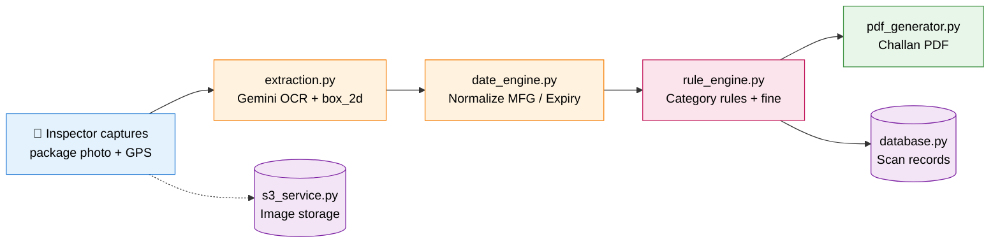
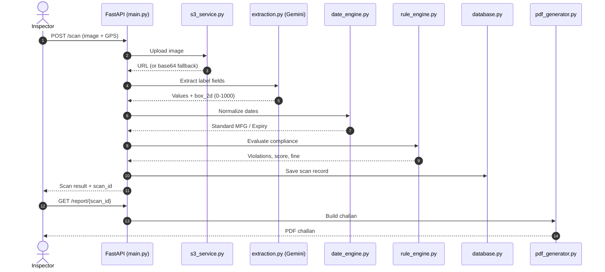
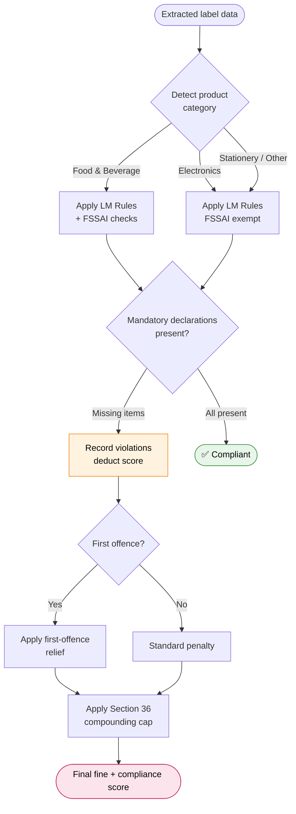
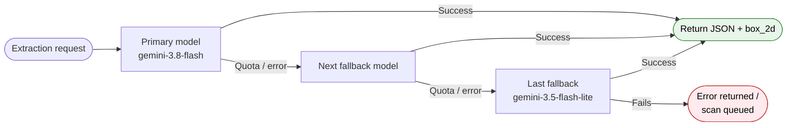
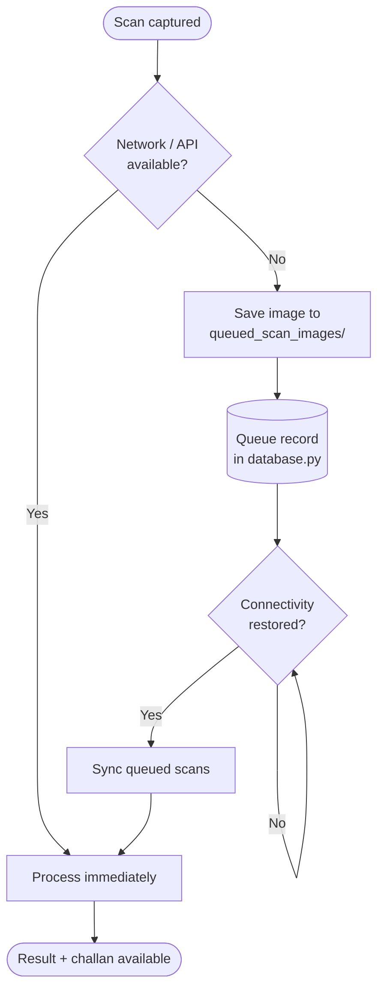
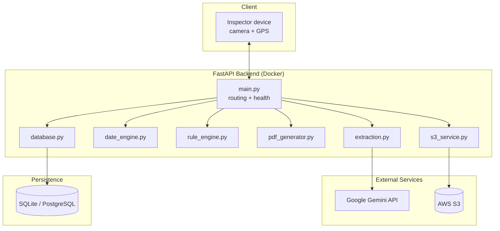

<div align="center">

# ⚖️ Legal Metrology Compliance Platform

**AI-powered, category-aware packaging label audit and enforcement for regulatory inspectors**


</div>

---

## Table of Contents

- [Overview](#overview)
- [Key Features](#key-features)
- [How It Works](#how-it-works)
  - [End-to-End Pipeline](#end-to-end-pipeline) · [Request Sequence](#request-sequence) · [Rule Engine Flow](#rule-engine-decision-flow) · [Model Fallback](#gemini-model-fallback) · [Offline Queue](#offline-queue--sync) · [Architecture](#system-architecture)
- [Technology Stack](#technology-stack)
- [Project Structure](#project-structure)
- [Core Modules](#core-modules)
- [Getting Started](#getting-started)
- [Configuration](#configuration)
- [API Reference](#api-reference)
- [Docker Deployment](#docker-deployment)
- [Regulatory Reference](#regulatory-reference)
- [Roadmap](#roadmap)
- [Disclaimer](#disclaimer)
- [License](#license)

---

## Overview

Enforcement officers traditionally inspect retail packages by hand, checking each label for the statutory declarations required under Indian law: MRP, net quantity, manufacturer details, country of origin, consumer care details, and FSSAI licence numbers. The process is slow, repetitive, and prone to inconsistency between inspectors.

The **Legal Metrology Compliance Platform** automates the full inspection lifecycle. An inspector photographs a package in the field, and the platform extracts the label text, evaluates it against the applicable rules for that product category, calculates the penalty, and produces an official challan PDF, all in one workflow.

## Key Features

| Feature | Description |
|---|---|
| 🔍 **Multimodal AI Extraction** | Google Gemini reads label text from package photos and returns spatial bounding boxes (`box_2d`) on a normalized **0–1000** coordinate grid. |
| 🧠 **Category-Aware Rule Engine** | Detects the product category (Food & Beverage, Electronics, Stationery, etc.) and applies the correct statutory requirements and exemptions, for example exempting non-food items from FSSAI and expiry checks. |
| 💰 **Automated Fine Calculation** | Evaluates infractions against **Section 36** of the Legal Metrology Act, applying compounding caps and first-offence relief rules. |
| 📄 **Professional PDF Challans** | Generates government-style inspection reports with GPS coordinates and a visual breakdown of violations using ReportLab. |
| 📅 **Date Normalization** | Parses messy manufacturing and expiry date formats found on real packages into a standard form. |
| 📡 **Offline Queue** | Scans captured with poor connectivity are queued locally and synchronized later. |
| ☁️ **Secure Cloud Storage** | Package images are uploaded to AWS S3, with a base64 data-URI fallback when S3 is unavailable. |
| 🔁 **Model Fallback Chain** | Automatically falls back across multiple Gemini models for resilience against quota or availability issues. |

## How It Works

### End-to-End Pipeline



1. **Capture**: the inspector uploads one or more package photos along with GPS coordinates.
2. **Extract**: Gemini returns structured JSON containing each declaration's text value and its bounding box.
3. **Normalize**: dates are parsed and standardized.
4. **Evaluate**: the rule engine detects the category, applies relevant rules and exemptions, deducts compliance score, and computes the fine.
5. **Report**: a challan PDF is generated and the scan is stored in history.

### Request Sequence



### Rule Engine Decision Flow



### Gemini Model Fallback



### Offline Queue & Sync



### System Architecture



> The diagrams above use [Mermaid](https://mermaid.js.org/), which renders natively on GitHub, GitLab and most Markdown viewers. The flow shown reflects the module responsibilities described in this document; adjust the branches if your implementation differs.

## Technology Stack

| Layer | Technologies |
|---|---|
| **Backend** | Python, FastAPI, Uvicorn |
| **AI Engine** | Google Gemini via the `google-genai` SDK, with multi-model fallback (`gemini-3.8-flash` down to `gemini-3.5-flash-lite`) |
| **Reports & Imaging** | ReportLab, Pillow |
| **Storage** | SQLite / PostgreSQL, AWS S3 (Boto3) |
| **HTTP** | Requests |
| **Deployment** | Docker |

## Project Structure

```
product_compliance/
└── backend/
    ├── queued_scan_images/   # Images held for offline queue sync
    ├── static/               # Static assets
    ├── .env                  # Environment variables (not committed)
    ├── database.py           # Persistent scan records & offline queue
    ├── date_engine.py        # MFG / expiry date normalization
    ├── Dockerfile            # Container configuration
    ├── extraction.py         # Gemini vision OCR & bounding box parser
    ├── main.py               # FastAPI app, routing & health checks
    ├── pdf_generator.py      # ReportLab challan generator
    ├── requirements.txt      # Python dependencies
    ├── rule_engine.py        # Legal Metrology & FSSAI rule engine
    └── s3_service.py         # S3 upload with base64 fallback
```

## Core Modules

| Module | Responsibility |
|---|---|
| **`main.py`** | FastAPI entrypoint. Exposes `/scan`, `/scan-multi`, `/history`, and `/report/{scan_id}` along with health checks. |
| **`extraction.py`** | Calls Gemini with multi-model fallback and a strict JSON schema, returning text values and `box_2d` boxes on the 0–1000 grid. |
| **`rule_engine.py`** | Evaluates compliance under Indian packaging law, deducts scores, and calculates compounding fines while respecting category exemptions. |
| **`pdf_generator.py`** | Builds category-aware, government-grade inspection challan PDFs with ReportLab. |
| **`date_engine.py`** | Standardizes manufacturing and expiry date formats. |
| **`s3_service.py`** | Handles secure uploads to AWS S3, falling back to base64 data URIs. |
| **`database.py`** | Manages scan records and offline queue synchronization. |

## Getting Started

### Prerequisites

- Python 3.10 or newer
- A [Google Gemini API key](https://aistudio.google.com/)
- (Optional) An AWS account and S3 bucket for image storage

### 1. Clone and install

```bash
git clone <your-repository-url>
cd product_compliance/backend

python -m venv venv
source venv/bin/activate        # Windows: venv\Scripts\activate

pip install -r requirements.txt
```

### 2. Configure environment variables

Create a `.env` file inside `backend/` (see [Configuration](#configuration)).

### 3. Run the server

```bash
uvicorn main:app --reload --port 8000
```

The API is now available at `http://localhost:8000`, and interactive docs at `http://localhost:8000/docs`.

## Configuration

Create `backend/.env`:

```env
GEMINI_API_KEY=your_google_genai_api_key_here
AWS_ACCESS_KEY_ID=your_aws_access_key
AWS_SECRET_ACCESS_KEY=your_aws_secret_key
AWS_STORAGE_BUCKET_NAME=your_s3_bucket_name
AWS_S3_REGION=ap-south-1
```

| Variable | Required | Description |
|---|---|---|
| `GEMINI_API_KEY` | ✅ | Google Gemini API key used for label extraction. |
| `AWS_ACCESS_KEY_ID` | Optional | AWS credentials for S3 uploads. |
| `AWS_SECRET_ACCESS_KEY` | Optional | AWS credentials for S3 uploads. |
| `AWS_STORAGE_BUCKET_NAME` | Optional | Target S3 bucket. |
| `AWS_S3_REGION` | Optional | S3 region (default shown: `ap-south-1`). |

> **Note:** If S3 credentials are not provided, images fall back to base64 data URIs.
> Never commit `.env` to version control. Make sure it is listed in `.gitignore`.

## API Reference

| Method | Endpoint | Description |
|---|---|---|
| `POST` | `/scan` | Submit a single package image for extraction and compliance evaluation. |
| `POST` | `/scan-multi` | Submit multiple images (e.g. front, back, side panels) of one package for a combined audit. |
| `GET` | `/history` | List previously stored scan records. |
| `GET` | `/report/{scan_id}` | Download the generated PDF challan for a scan. |

Full request and response schemas are available in the auto-generated Swagger UI at `/docs`.

### Bounding Box Format

Each extracted field includes a `box_2d` value on a normalized 0–1000 grid, independent of the original image resolution:

```json
{
  "field": "mrp",
  "value": "₹ 120.00",
  "box_2d": [ymin, xmin, ymax, xmax]
}
```

To convert to pixels: `pixel_x = (x / 1000) * image_width` and `pixel_y = (y / 1000) * image_height`.

## Docker Deployment

```bash
cd backend
docker build -t legal-metrology-platform .
docker run -d \
  --name lm-platform \
  --env-file .env \
  -p 8000:8000 \
  legal-metrology-platform
```

## Regulatory Reference

| Instrument | Relevance |
|---|---|
| **Legal Metrology (Packaged Commodities) Rules, 2011** | Mandates declarations of MRP, net quantity, manufacturer details, consumer care, and country of origin. |
| **Legal Metrology Act, 2009** | Governs Section 36 offences and compounding of fines. |
| **FSSAI Packaging and Labelling Regulations, 2011** | Governs mandatory licence numbers and expiry declarations for food and beverage items. |

## Roadmap

- [ ] Mobile inspector companion app with offline-first capture
- [ ] Barcode / QR cross-verification against product databases
- [ ] Multilingual label support (Hindi and regional languages)
- [ ] Inspector dashboard with analytics and violation trends
- [ ] Role-based access control and audit logging

## Disclaimer

This platform is an inspection **aid**. AI-extracted values and computed penalties should be verified by an authorized officer before any enforcement action is taken. Statutory provisions, fine schedules, and exemptions are subject to amendment; always confirm against current notifications.

## License

Developed for regulatory compliance enforcement and inspection automation. Add your chosen license (e.g. MIT, Apache-2.0, or a proprietary/government license) in a `LICENSE` file and update this section accordingly.
