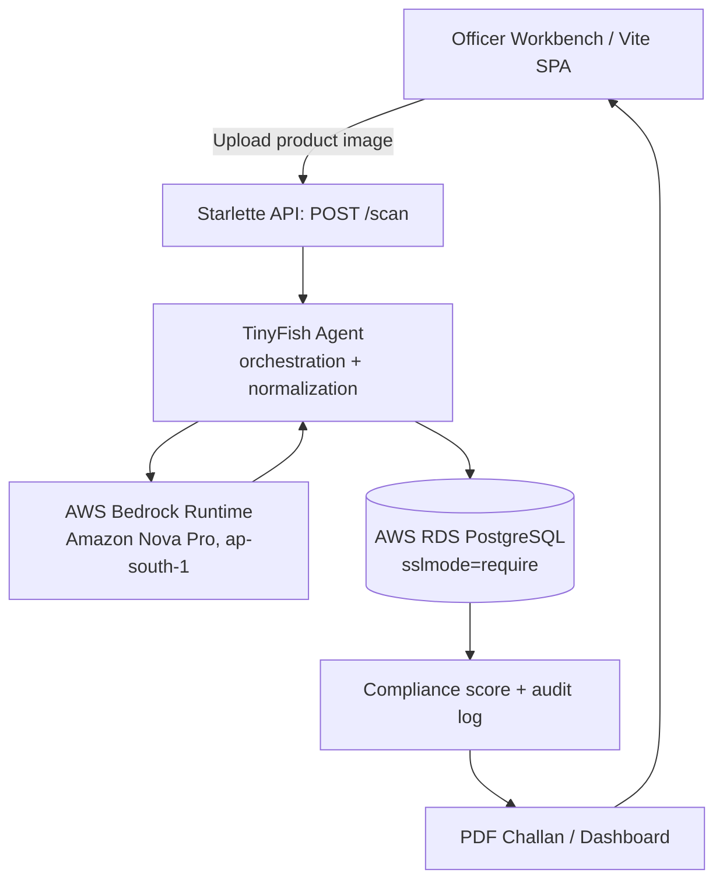

# Legal Metrology Enforcement Application

> AI-assisted statutory compliance auditing for packaged commodities, built for enforcement officers.


-009688)


---

## Table of Contents

1. [Overview](#1-overview)
2. [Key Features](#2-key-features)
3. [Architecture](#3-architecture)
4. [Technology Stack](#4-technology-stack)
5. [Role of TinyFish](#5-role-of-tinyfish)
6. [Operational Workflow](#6-operational-workflow)
7. [Statutory Parameters Extracted](#7-statutory-parameters-extracted)
8. [Getting Started](#8-getting-started)
9. [Configuration](#9-configuration)
10. [API Reference](#10-api-reference)
11. [Database](#11-database)
12. [Deployment (Vercel)](#12-deployment-vercel)
13. [Security & Compliance](#13-security--compliance)
14. [Reliability & Error Handling](#14-reliability--error-handling)
15. [Observability](#15-observability)
16. [Troubleshooting & Resolved Incidents](#16-troubleshooting--resolved-incidents)
17. [Project Structure](#17-project-structure)
18. [Testing](#18-testing)
19. [Roadmap](#19-roadmap)
20. [Contributing](#20-contributing)
21. [License](#21-license)

---

## 1. Overview

The **Legal Metrology Enforcement Application** is a high-performance Python/Starlette web platform that lets enforcement officers automate the inspection of product packaging. An officer uploads or captures a photo of a product label; the system extracts the mandatory declarations required under Legal Metrology (Packaged Commodities) regulations, scores the product for compliance, stores an auditable record, and generates a PDF challan on demand.

**The problem:** manual label inspection is slow, inconsistent between officers, and hard to audit.

**The solution:** an agentic pipeline combining TinyFish for orchestration and normalization, Amazon Nova Pro (via AWS Bedrock) for multimodal vision analysis, and AWS RDS PostgreSQL for durable, queryable audit trails.

## 2. Key Features

| Capability | Description |
|---|---|
| **Officer Workbench** | Upload or snap label imagery and run an audit in a single flow. |
| **Automated Parameter Extraction** | Extracts MRP, Net Quantity, Manufacturer details, and Consumer Care information. |
| **Compliance Scoring** | Calculates a compliance score per inspection based on extracted declarations. |
| **PDF Challan Generation** | Renders instant, printable challans from audit results. |
| **Analytics Dashboard** | Aggregated views over historical inspections. |
| **Live Sync Indicators** | Real-time status of scan, inference, and persistence stages. |
| **Serverless Scale** | Runs on Vercel Serverless Functions with no servers to manage. |
| **Encrypted Persistence** | AWS RDS PostgreSQL in Mumbai (`ap-south-1`) with mandatory SSL. |

## 3. Architecture



**Design principles**

- **Stateless compute:** Vercel functions hold no state; all persistence is in RDS.
- **Separation of concerns:** orchestration (TinyFish), inference (Nova Pro), and storage (PostgreSQL) are independently replaceable.
- **Region affinity:** Bedrock and RDS both run in `ap-south-1` to minimize latency and keep data in-region.
- **Secure by default:** secrets are injected via Vercel; database traffic is always encrypted.

## 4. Technology Stack

| Layer | Technology |
|---|---|
| Backend framework | Python, Starlette (ASGI) |
| Hosting | Vercel Serverless Functions |
| Extraction agent | TinyFish (`tinyfish==0.9.0`) |
| Vision / AI | AWS Bedrock Runtime via `boto3`, Amazon Nova Pro |
| Resilience | `tenacity` (retry/backoff) |
| Database | AWS RDS PostgreSQL (`ap-south-1`, SSL required) |
| Frontend | Vite SPA |
| Reporting | Client/server PDF challan generation |

## 5. Role of TinyFish

TinyFish (`tinyfish==0.9.0`) is the orchestration and extraction middleware at the center of the pipeline.

1. **Automated inspection parsing:** when an officer uploads a label image, TinyFish initializes structural parsing routines for the incoming media.
2. **Agentic vision handshake:** it coordinates payload handoff between the frontend request and the downstream multimodal pipeline (Amazon Nova Pro on Bedrock).
3. **Data normalization:** it converts raw, unstructured model output into clean statutory parameters (MRP, Net Quantity, Manufacturer, Consumer Care) before anything is persisted.
4. **Resilient error boundaries:** it supports graceful degradation and retry behavior (with companion libraries such as `tenacity`) to keep serverless execution dependable.

## 6. Operational Workflow

1. **Capture:** the officer starts a scan from the dashboard.
2. **Orchestration:** the request reaches the Starlette `/scan` endpoint, where TinyFish processes and structures the media stream.
3. **Inference:** Amazon Nova Pro analyzes the label for statutory compliance.
4. **Persistence & reporting:** results are saved to PostgreSQL, the compliance score is computed, and a PDF challan can be rendered immediately.

## 7. Statutory Parameters Extracted

| Parameter | Purpose |
|---|---|
| **MRP** | Maximum Retail Price declaration (inclusive of all taxes). |
| **Net Quantity** | Declared quantity by weight, volume, or count. |
| **Manufacturer / Packer details** | Name and address of the responsible entity. |
| **Consumer Care** | Contact details for consumer complaints. |

> Compliance rules are defined by the applicable Legal Metrology (Packaged Commodities) regulations. Always validate scoring logic against the current notified rules before operational use.

## 8. Getting Started

### Prerequisites

- Python 3.11+
- Node.js 18+ and npm (for the Vite frontend)
- An AWS account with Bedrock model access to **Amazon Nova Pro** in `ap-south-1`
- An AWS RDS PostgreSQL instance reachable from your deployment
- A TinyFish API key
- Vercel CLI (`npm i -g vercel`) for local serverless emulation

### Installation

```bash
# Clone
git clone <your-repo-url>
cd legal-metrology-app

# Backend
python -m venv .venv
source .venv/bin/activate        # Windows: .venv\Scripts\activate
pip install -r requirements.txt

# Frontend
cd frontend
npm install
cd ..
```

### Run locally

```bash
# Copy and fill environment variables (see Configuration)
cp .env.example .env

# Option A: Vercel dev (mirrors production)
vercel dev

# Option B: ASGI server directly
uvicorn app.main:app --reload --port 8000

# Frontend (separate terminal)
cd frontend && npm run dev
```

## 9. Configuration

All secrets are managed in Vercel and must be scoped to **Production, Preview, and Development**.

| Variable | Description | Scope |
|---|---|---|
| `TINYFISH_API_KEY` | Authentication token for TinyFish agent execution | All environments (Secret) |
| `AWS_ACCESS_KEY_ID` | IAM user access key (`legal-metrology-app-user`) | All environments (Secret) |
| `AWS_SECRET_ACCESS_KEY` | IAM user secret access key | All environments (Secret) |
| `AWS_REGION` / `AWS_S3_REGION` | Regional endpoint for AWS services (`ap-south-1`) | All environments |
| `DATABASE_URL` | PostgreSQL connection URI with SSL enforced | All environments (Secret) |

**`DATABASE_URL` format**

```text
postgresql://<DB_USER>:<DB_PASSWORD>@<RDS_ENDPOINT>.ap-south-1.rds.amazonaws.com:5432/<DB_NAME>?sslmode=require
```

> **Never commit real credentials.** Keep `.env` in `.gitignore` and use only placeholders in documentation and examples.

## 10. API Reference

> The `/scan` endpoint is part of the documented architecture. Request and response shapes below are illustrative; align them with the implemented schema.

### `POST /scan`

Submits a product label image for extraction and compliance scoring.

**Request**

```http
POST /scan
Content-Type: multipart/form-data

image: <file>
```

**Response (illustrative)**

```json
{
  "inspection_id": "uuid",
  "extracted": {
    "mrp": "string",
    "net_quantity": "string",
    "manufacturer": "string",
    "consumer_care": "string"
  },
  "compliance_score": 0.0,
  "status": "completed"
}
```

**Errors**

| Code | Meaning |
|---|---|
| `400` | Missing or invalid image payload |
| `401` | Authentication failure |
| `502` | Upstream failure (Bedrock / TinyFish) after retries |
| `500` | Unexpected server error |

## 11. Database

- **Engine:** AWS RDS PostgreSQL
- **Region:** Mumbai (`ap-south-1`)
- **Transport security:** SSL mandatory via `?sslmode=require`
- **Stores:** audit logs, extracted statutory parameters, compliance scores

**Operational guidance**

- Use alphanumeric master passwords to avoid URI-encoding issues in the connection string.
- Restrict the RDS security group to known ingress sources.
- Enable automated backups and a defined retention period.
- Use a dedicated least-privilege application role rather than the master user.

## 12. Deployment (Vercel)

1. **Verify scoping:** confirm all secrets are enabled for Production, Preview, and Development.
2. **Deploy:** push to the connected branch or run `vercel --prod`.
3. **Cache-free redeployment** (required after changing secrets):
   - Open the Vercel **Deployments** tab.
   - Select **Redeploy** on the target deployment.
   - **Uncheck "Use existing Build Cache"** so fresh secrets are injected.

## 13. Security & Compliance

| Area | Practice |
|---|---|
| Secrets | Stored as Vercel Secrets; never in source control. |
| Data in transit | TLS everywhere; PostgreSQL requires `sslmode=require`. |
| Data residency | Compute inference and storage in `ap-south-1`. |
| IAM | Dedicated IAM user with least-privilege Bedrock access only. |
| Auditability | Every inspection is persisted with extracted values and score. |
| Rotation | Rotate AWS keys, DB passwords, and API tokens on a regular schedule and after any suspected exposure. |

**Recommended hardening**

- Replace long-lived IAM user keys with short-lived credentials (e.g., OIDC federation from Vercel) where possible.
- Move the RDS instance behind private networking and use a connection pooler such as RDS Proxy for serverless workloads.
- Add authentication, role-based access control, and rate limiting on `/scan`.
- Apply image size and type validation before invoking any model.

## 14. Reliability & Error Handling

- **Retries:** transient failures are retried with exponential backoff using `tenacity`.
- **Graceful degradation:** TinyFish error boundaries return structured failures rather than unhandled exceptions.
- **Idempotency:** design scan submissions so retries do not create duplicate audit records.
- **Serverless considerations:** keep cold-start work light, reuse clients across invocations, and use connection pooling for PostgreSQL.

## 15. Observability

- Use Vercel function logs for request and error tracing.
- Track key metrics: scan latency, Bedrock error rate, retry counts, extraction confidence, and compliance score distribution.
- Add alerting for sustained 5xx rates and database connection failures.

## 16. Troubleshooting & Resolved Incidents

| Symptom | Cause | Resolution |
|---|---|---|
| Bedrock `AccessDeniedException` on a new AWS account | Automated account verification hold on foundation model access, lasting up to ~2 hours | Wait for verification to complete, then retry. Confirm model access is enabled in `ap-south-1`. |
| PostgreSQL authentication or encryption errors | Special characters in the master password and/or missing SSL enforcement | Use an alphanumeric master password and append `?sslmode=require` to `DATABASE_URL`. |
| Updated secrets not taking effect | Stale build cache | Redeploy with **"Use existing Build Cache"** unchecked. |
| Missing variables in Preview/Development | Secret not scoped to all environments | Enable each secret for Production, Preview, and Development. |

## 17. Project Structure

> Adjust to match the actual repository layout.

```text
.
├── api/                  # Vercel serverless entrypoints
├── app/
│   ├── main.py           # Starlette application and routes
│   ├── agents/           # TinyFish orchestration and normalization
│   ├── vision/           # Bedrock / Nova Pro client
│   ├── db/               # PostgreSQL access and models
│   └── reports/          # Challan / PDF generation
├── frontend/             # Vite SPA
├── tests/
├── requirements.txt
├── vercel.json
└── README.md
```

## 18. Testing

```bash
pytest -q                 # backend unit and integration tests
cd frontend && npm test   # frontend tests
```

Recommended coverage: normalization logic, scoring rules, retry behavior, database persistence, and a golden set of labeled product images for regression testing of extraction accuracy.

## 19. Roadmap

- [ ] Role-based access control and officer identity management
- [ ] Batch and multi-image inspections
- [ ] Offline-capable mobile capture
- [ ] Multilingual label support
- [ ] Configurable compliance rule engine
- [ ] Exportable analytics and scheduled reports
- [ ] Human-in-the-loop review for low-confidence extractions

## 20. Contributing

1. Fork the repository and create a feature branch: `git checkout -b feature/<name>`
2. Follow existing code style and add tests for new behavior.
3. Never include secrets or real inspection data in commits.
4. Open a pull request with a clear description and linked issue.

## 21. License

Specify your license here (e.g., MIT, Apache-2.0, or proprietary). If this system is operated for a government or regulatory body, confirm the applicable licensing and data-handling policies.

---

*Maintained by the Legal Metrology Enforcement engineering team.*
